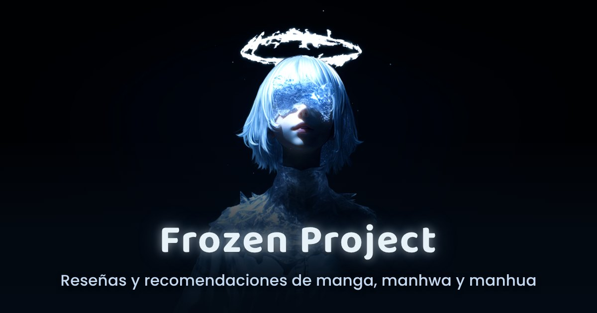

# Frozen Project

**Reseñas y recomendaciones de manga, manhwa y manhua, según lo que opina la comunidad.**

👉 **[frozen-project.vercel.app](https://frozen-project.vercel.app)**



Frozen Project es un catálogo para decidir qué leer. En vez de una sola opinión, cada obra junta lo que piensan los lectores de AniList, MyAnimeList, Kitsu y MangaUpdates.

Es un proyecto personal, gratis y sin fines comerciales: no tiene publicidad ni herramientas para seguir lo que haces.

## Qué puedes hacer

- **Buscar y filtrar:** encuentra una obra por cualquiera de sus nombres, filtra por tipo (manga, manhwa o manhua), género, etiqueta, estado, año, extensión (por capítulos), si tiene anime o edición en español, oculta los géneros que no quieres ver y ordena por popularidad o fecha de salida.
- **Ver lo que opina la comunidad:** un puntaje que combina cuatro comunidades, qué tan confiable es, cómo se reparten los votos, qué se elogia y qué se critica, un resumen corto de las reseñas, sin spoilers y hecho por IA, y sellos como «Aclamada en las 4 comunidades» o «Joya poco conocida».
- **Saber dónde leerla:** solo enlaces oficiales, primero en español o inglés.
- **Saber en qué orden leerla:** sus precuelas y secuelas en orden (JoJo tiene 9 partes), con la obra que estás viendo marcada, y sus historias paralelas y spin-offs.
- **Saber si tiene anime:** sus adaptaciones y dónde verlas oficialmente, primero en los servicios que llegan a Latinoamérica y España.
- **Ver qué está de moda:** lo más popular de hoy, de la semana y del mes, y las obras más recientes en salir.
- **Armar tu biblioteca:** marca obras como Leyendo, Por leer, Leído, En pausa, Abandonado o Favorito. Funciona sin cuenta (se guarda en tu navegador) y, si entras con Google o Discord, se sincroniza en todos tus dispositivos. También puedes traer tu lista de AniList o MyAnimeList.
- **Recibir recomendaciones para ti:** con tus favoritas y lo que leíste, el Inicio te muestra obras de la misma historia, del mismo autor, las que recomiendan los lectores de AniList y las parecidas. Se calcula en tu navegador.
- **Compartir una obra:** cada una tiene su propia página (por ejemplo, [frozen-project.vercel.app/obra/berserk/](https://frozen-project.vercel.app/obra/berserk/)). Al mandarla por WhatsApp o Discord salen su portada y su título, y Google la puede encontrar.

## Cómo funciona

La página es un sitio estático (HTML, CSS y JavaScript, sin frameworks ni paso de compilación) publicado en [Vercel](https://vercel.com). Los datos se actualizan solos y gratis con GitHub Actions:

| Tarea | Cuándo | Qué hace |
|---|---|---|
| `comunidad.yml` | De lunes a viernes, 4:17 a. m. | Trae el catálogo de AniList (con el orden de lectura y el anime), suma hasta 20 obras nuevas, calcula lo que opina la comunidad, escribe los resúmenes y arma la lista, las fichas, la página de cada obra y el mapa del sitio |
| `populares.yml` | Todos los días, 5:41 a. m. y 5:41 p. m. | Actualiza la popularidad y la actividad de cada obra |
| `mantener-supabase.yml` | Todos los días, 9:23 a. m. | Evita que la base de datos gratuita se pause |
| `medir-gemma.yml` | A mano | Mide qué tan rápido se escriben los resúmenes |

Las horas son de Colombia. GitHub atrasa sus tareas programadas cuando tiene mucha carga (a veces varias horas) y a veces no las corre, así que las tres primeras las lanza [cron-job.org](https://cron-job.org) a su hora, con la API de GitHub (`workflow_dispatch`) y un token que solo puede lanzar tareas de este repositorio. El horario de cada tarea en GitHub queda de respaldo: si un día llegan las dos, la segunda casi no hace trabajo (salta las obras que ya se renovaron y no pasa de 20 obras nuevas por día).

- **Lo que opina la comunidad:** el puntaje combinado pesa a cada comunidad según sus votos. Un modelo BERT multilingüe (con Transformers.js) lee las reseñas para saber qué se elogia y qué se critica, y Gemma 4 (con Ollama) escribe los resúmenes. Todo corre dentro de la misma tarea de GitHub: las reseñas no se mandan a ningún otro servicio.
- **Cuentas:** [Supabase](https://supabase.com), para entrar con Google o Discord y guardar la biblioteca en una tabla con reglas de seguridad por fila. El esquema está en `supabase/esquema.sql`.

Cada cálculo se explica con detalle en [Sobre el sitio](https://frozen-project.vercel.app/#sobre).

## Qué hay en el repositorio

| Archivo o carpeta | Para qué sirve |
|---|---|
| `index.html`, `styles.css` | La página y su diseño |
| `sitio.js` | La navegación entre secciones |
| `catalogo.js` | El Inicio, el catálogo y la ficha de cada obra |
| `obra/`, `obra.js`, `sitemap.xml` | La página propia de cada obra (para compartirla y para Google) y el mapa del sitio; las genera `scripts/paginas.mjs`, no se editan a mano |
| `biblioteca.js`, `importar.js`, `cuenta.js` | Mi biblioteca, importar listas y la cuenta |
| `catalogo.json` | La lista de obras; se puede editar a mano (ver abajo) |
| `obras.json`, `datos/` | Lo que generan las tareas; no se editan a mano |
| `scripts/` | Las tareas que corren en GitHub Actions |
| `supabase/` | El esquema de la base de datos y una prueba de sus reglas |
| `vendor/` | La librería de Supabase (supabase-js) |
| `Video/` | El fondo animado |
| `googleb0036672334535d5.html` | La verificación de Google Search Console (no borrar) |

## Agregar o quitar obras

Las obras nuevas entran solas, pero también se puede hacer a mano en `catalogo.json`:

- **Agregar:** busca la obra en AniList, copia el número de su enlace (en `https://anilist.co/manga/105398/Solo-Leveling` es `105398`) y agrega al final `{ "anilist": 105398 }`.
- **Quitar:** borra su línea. Si había entrado sola, no vuelve.
- **Que nunca entre sola:** pon su número en `"excluidas"`.

La tarea de GitHub completa el resto (título, autores, géneros, portada, capítulos y dónde leer) y publica la página.

## Probarlo en tu computador

```bash
git clone https://github.com/Sorryfriend49/Sorryfriend49.github.io.git
cd Sorryfriend49.github.io
python3 -m http.server 8000
```

Luego abre <http://localhost:8000>. Entrar con Google o Discord depende de cómo está configurado Supabase, así que puede no funcionar en local.

Para correr una tarea a mano hace falta Node.js 20 o más:

```bash
npm ci --prefix scripts
node scripts/catalogo.mjs
node scripts/comunidad.mjs   # MyAnimeList es opcional: necesita la variable MAL_CLIENT_ID
node scripts/lista.mjs
```

## Créditos

- **Datos:** [AniList](https://anilist.co), [MyAnimeList](https://myanimelist.net), [Kitsu](https://kitsu.app) y [MangaUpdates](https://www.mangaupdates.com). Las obras y sus portadas pertenecen a sus autores y editoriales.
- **Modelo de sentimiento:** [BERT multilingüe de NLP Town](https://huggingface.co/nlptown/bert-base-multilingual-uncased-sentiment) (licencia MIT).
- **Resúmenes:** [Gemma 4](https://ai.google.dev/gemma) de Google (licencia Apache 2.0).
- **Fondo animado:** Blind Angel, de [MoeWalls](https://moewalls.com).
- **Tipografías:** Baloo 2 y Poppins, de [Google Fonts](https://fonts.google.com).
- **Cuentas:** [Supabase](https://supabase.com) y su librería supabase-js (licencia MIT).
